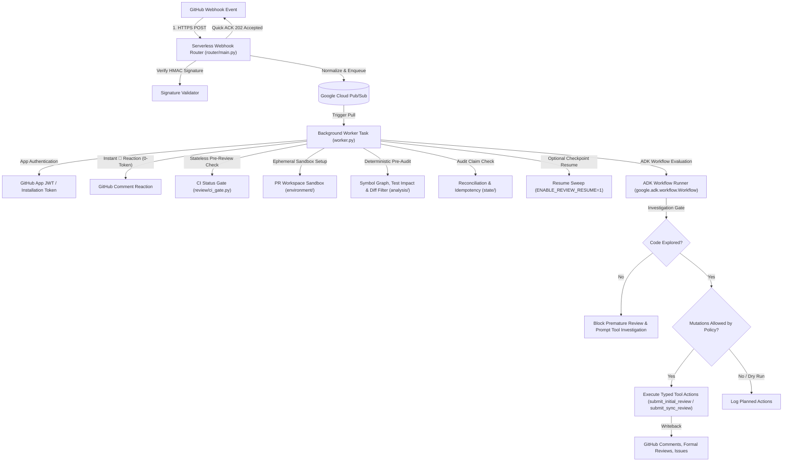

# 🤖 Hannibal Hub Agents: Distributed GitHub App Webhook Orchestrator

[](https://github.com/cgj8702-org/hannibal-hub-agents/actions/workflows/ci.yml)
[](https://github.com/cgj8702-org/hannibal-hub-agents/actions/workflows/deploy.yml)
[](https://www.python.org/downloads/release/python-3130/)
[](https://github.com/astral-sh/uv)

A unified, event-driven service that handles GitHub webhooks via a serverless router, queues event processing asynchronously using **Google Cloud Pub/Sub**, and runs an agentic workflow powered by **Gemini 3.8 / 3.5 / 3.1 Flash**, **Google GenAI**, and **Google ADK** to safely orchestrate GitHub repository reviews, review-thread collaboration, and proactive PR hygiene sweeps.

---

## 🏗️ System Architecture

The orchestrator uses a decoupled, distributed architecture featuring asynchronous event processing, deterministic pre-audits, sandboxed execution, and an ADK review & collaboration engine:



---

## 📁 Repository Structure

```
├── .agents/skills/          # Localized agent operational skills
│   ├── gcloud-logging/      # GCP logging inspection protocol & project matrix
│   └── github-pr-manager/   # End-to-end GitHub PR lifecycle management
├── .github/workflows/       # GitHub Actions CI PR gate & VM deployment workflows
│   ├── ci.yml               # Automated lint, formatting, typecheck, and test gate
│   └── deploy.yml           # Automated CI/CD deployment to VM via IAP SSH ($GITHUB_SHA pinned)
├── .githooks/pre-commit     # Tracked commit gate (lint, format, typecheck on staged Python)
├── assets/                  # Static assets and model registries
│   └── registries/          # Gemini model specs and capabilities (gemini_models.json)
├── dev/                     # Developer tools (rate limits, fixture recording, token analysis)
├── docs/                    # Canonical architectural & operational documentation
│   ├── CHECKPOINT_RESUME.md # PR review resume & checkpoint mechanics
│   ├── LOG_SINK_SETUP.md    # Cloud Logging setup and export configuration
│   ├── MODEL_CHAIN.md       # Model fallback chains, tiering, and rate limits
│   ├── review_rules.md      # Review policies, invariants, and scorecard rules
│   ├── slash_commands_catalog.md # Supported webhook slash commands
│   └── templates_catalog.md # Review output schemas and markdown templates
├── scripts/
│   ├── load_secrets.sh      # Load environment variables dynamically from GCP Secret Manager
│   ├── setup_vm_user_service.sh   # VM user-space systemd service setup script
│   ├── hannibal-webhook-agent.service # User-space systemd unit file template
│   ├── ruff-all.sh                # Lint, format, and type-check runner shared with the hook
│   └── install-git-hooks.sh       # Pre-commit hook installer for lint & type validation
├── src/
│   ├── webhook_agent/       # Core Webhook Orchestrator Package (hatchling editable package)
│   │   ├── analysis/        # Deterministic pre-audits (symbol graph, test impact, diff filter, lockfile, security scanner)
│   │   ├── core/            # ADK WebhookAgent, prompts, execution engine, event policy, callbacks, & plugins
│   │   ├── environment/     # Local & ephemeral PR workspace sandboxes (path_under_root containment)
│   │   ├── github/          # GitHub App auth, credentials caching, bot identity, PR context, thread resolver
│   │   ├── models/          # Dynamic model chains, rate limiters, depleted-model registry, & factory
│   │   ├── review/          # Structured Pydantic review schemas, verdict enforcer, grounding, AST/CI gates, formatting
│   │   ├── state/           # Review checkpoints (14d sliding TTL), audit reconciliation, circuit breaker, & idempotency
│   │   ├── tools/           # Model-callable typed tools (GitHub API, typed reviews, search, sandbox AST analysis)
│   │   ├── worker.py        # Pub/Sub subscriber entry point and sequential pull / sweep loop
│   │   ├── processor.py     # Event routing, deduplication, fast-paths, prefetch, & agent delegation
│   │   ├── constants.py     # Centralized infrastructure constants and dynamic env-var defaults
│   │   └── webhook_types.py # Common dataclasses and ActionResult definitions
├── router/                  # Serverless webhook ingress (Cloud Functions / Cloud Run entry point)
│   ├── main.py              # HMAC verify, event classify, normalize, Pub/Sub publish
│   └── requirements.txt     # Router-only deploy dependencies
├── tests/
│   ├── eval/                # Continuous quality evaluation datasets & configs
│   ├── fixtures/            # Sample webhook payloads & review event fixtures
│   └── unit/                # Domain-mirrored unit test suite (analysis, core, environment, github, models, review, router, state, tools)
├── main.py                  # Distributed process manager entry point
├── pyproject.toml           # Editable package specification (hatchling build-system) & pytest config
└── README.md                # Repository documentation
```

> **Note:** `router/` is deployed independently of this repository's workflows — `.github/workflows/deploy.yml` only updates the VM worker, so changes under `router/` require a manual function redeploy.

---

## ⚡ High-Efficiency Token Optimization & Advanced Features

The project includes built-in strategies to maximize context efficiency, eliminate unnecessary LLM calls, and execute reliable, automated PR reviews:

1. **Deterministic Event Policy Classification**:
   - Scope is classified deterministically by `resolve_event_policy()` (`core/policy.py`) before any model call:
     - `FORMAL_AUDIT`: PR lifecycle events (`pull_request.opened`, `pull_request.synchronize`, `pull_request.ready_for_review`, or `/review` command).
     - `THREAD_COLLAB`: Inline review comment threads from human engineers.
     - `ISSUE_TRIAGE`: Issue opened or commented events.
     - `GENERAL_PAIR_PROGRAMMING`: Conversational engineering discussion on PR/issue threads.
     - `IGNORE`: Own bot events, partner bot non-actionable comments, closed PRs, and suppressed webhook activities.

2. **Ephemeral PR Workspace Sandboxing (`ENABLE_PR_WORKSPACE=1`)**:
   - Clones the PR head commit into an isolated sandbox container with strict `path_under_root` boundary checks, eliminating VM host disk bleed and ensuring `read_file`, `list_dir`, and AST tools inspect the exact commit being reviewed.

3. **Mandatory Investigation Gate**:
   - Strictly blocks premature review tool calls on code PRs until the agent has actively inspected the repository using `search_files` or `read_file`.

4. **Typed ADK Review Tools (`submit_initial_review` / `submit_sync_review`)**:
   - Replaces fragile JSON string double-serialization (`review(body: str)`) with direct Pydantic model arguments (`CodeReviewResponse`, `SyncReviewResponse`), leveraging native OpenAPI 3.0 schema generation and argument validation in Google ADK.

5. **Prompt Injection & Mutation Defense**:
   - Gating in `before_tool_callback` and inside tool implementations ensures `create_issue` is strictly restricted to authorized policy modes (`may_create_issue=True`), preventing untrusted comments from triggering arbitrary issue spawning.
   - Review tools (`submit_initial_review`, `submit_sync_review`, `review`) are locked to `FORMAL_AUDIT` mode.

6. **Tier-Aware Model Chains & 503 Failover**:
   - Dynamically cascades models per request: primary `gemini-3.5-flash-lite` across tiers, escalating to `gemini-3.8-flash` for deep audits.
   - Features instant `0.5s` failover on `503 UNAVAILABLE` high-demand server spikes while preserving 429 rate limit backoff.

7. **Deterministic Pre-Audits & Audit Reconciliation**:
   - Pre-audits symbol dependencies, test coverage impacts, and diff filters before invoking the agent.
   - Enforces in-flight audit reconciliation claims (`state/reconciliation.py`) and idempotency checks (`state/review_idempotency.py`) to prevent duplicate reviews across concurrent webhook deliveries.

8. **Stateless CI Gate (`review/ci_gate.py`)**:
   - Defers automatic reviews until the PR head commit has 100% green CI check runs (`REVIEW_WAIT_FOR_CI=1`), preventing wasted tokens on failing builds.

9. **Guarded Programmatic 👀 Reaction**:
   - Immediately adds an `eyes` reaction to user comments and actionable PR events once deduplication locks pass.

---

## ⚙️ Configuration & Environment Variables

Key runtime switches and defaults:

| Variable | Default | Description |
| :--- | :--- | :--- |
| `TRIGGER_ALLOWED_ASSOCIATIONS` | `OWNER,MEMBER,COLLABORATOR,CONTRIBUTOR` | Permitted author associations for triggering actions. |
| `TRIGGER_EXEMPT_LOGINS` | `cgj8702,cgj8702-agents,dependabot[bot]` | User/bot logins exempt from author association checks. |
| `ENABLE_PR_WORKSPACE` | `1` | Clone PR head into an ephemeral sandbox workspace for accurate AST and file analysis (`1` = enabled, `0` = disabled). |
| `ALLOW_AUTOMATED_MUTATIONS` | `1` | Master policy gate for automated writeback actions (comments, formal reviews). |
| `REVIEW_WAIT_FOR_CI` | `1` | Hold automatic reviews until every CI check on the PR head commit is green (`1` = enabled, `0` = review immediately). |
| `ENABLE_AUTOMATIC_PR_REVIEWS` | `1` | Review opened/synchronized PRs automatically once CI is green (`0` = require manual `/review` triggers). |
| `ENABLE_REVIEW_RESUME` | `0` | Enable periodic background sweep resuming paused review checkpoints. |
| `REVIEW_RESUME_INTERVAL_SECONDS` | `60` | Interval in seconds between checkpoint resume sweeps. |
| `WEBHOOK_TIER` | `free` | Active model tier (`free` or `paid`), determining Gemini model cascade and API keys. |
| `STRICT_REVIEW_GROUNDING` | `1` | When `1`, downgrade review submissions whose citations cannot be verified against the diff. Set `0` to log only. |
| `LOG_MODEL_THOUGHTS` | `1` | Enable detailed debug logging for model prompts, responses, and token usage in Cloud Logging. |
| `DRY_RUN` | `0` | Log every planned mutation without writing anything back to GitHub. |

---

## 🚀 Getting Started & Development Gate

### 1. Installation
This project uses `uv` for package management and includes an editable `[build-system]` (`hatchling`):

```bash
# Sync dependencies and install the editable package
uv sync

# Install the pre-commit hook (once per clone)
./scripts/install-git-hooks.sh
```

### 2. Lint, Format & Static Type-Checking
The repository enforces clinical code hygiene with zero tolerance for syntax, lint, or type errors:

```bash
# Run Ruff lint, Ruff format, and MyPy type-checking
./scripts/ruff-all.sh
```

### 3. Running Tests
Run tests through `uv` (offline-first; network and Gemini calls are mocked):

```bash
# Run one test file
uv run pytest tests/unit/core/test_callbacks.py

# Run all unit tests
uv run pytest tests/unit

# Run full test suite (matching CI PR Gate)
uv run pytest --tb=short -q
```

---

## 🛠️ Operations & Deployment

### Running the Background Worker Locally
```bash
uv run python main.py
```

### VM Deployment & Service Management
The production worker runs on GCE VM `hannibal-hub-free` in project `chatbot-project-hannibal`:

```bash
# Service status
systemctl --user status hannibal-webhook-agent.service

# Restart service
systemctl --user restart hannibal-webhook-agent.service

# Follow live logs
journalctl --user -u hannibal-webhook-agent.service -f
```

Pushes to `main` touching `src/`, `scripts/`, `main.py`, `pyproject.toml`, `uv.lock`, or `.github/workflows/deploy.yml` automatically trigger [`.github/workflows/deploy.yml`](.github/workflows/deploy.yml) to deploy `$GITHUB_SHA` via IAP SSH and restart `hannibal-webhook-agent.service`.
