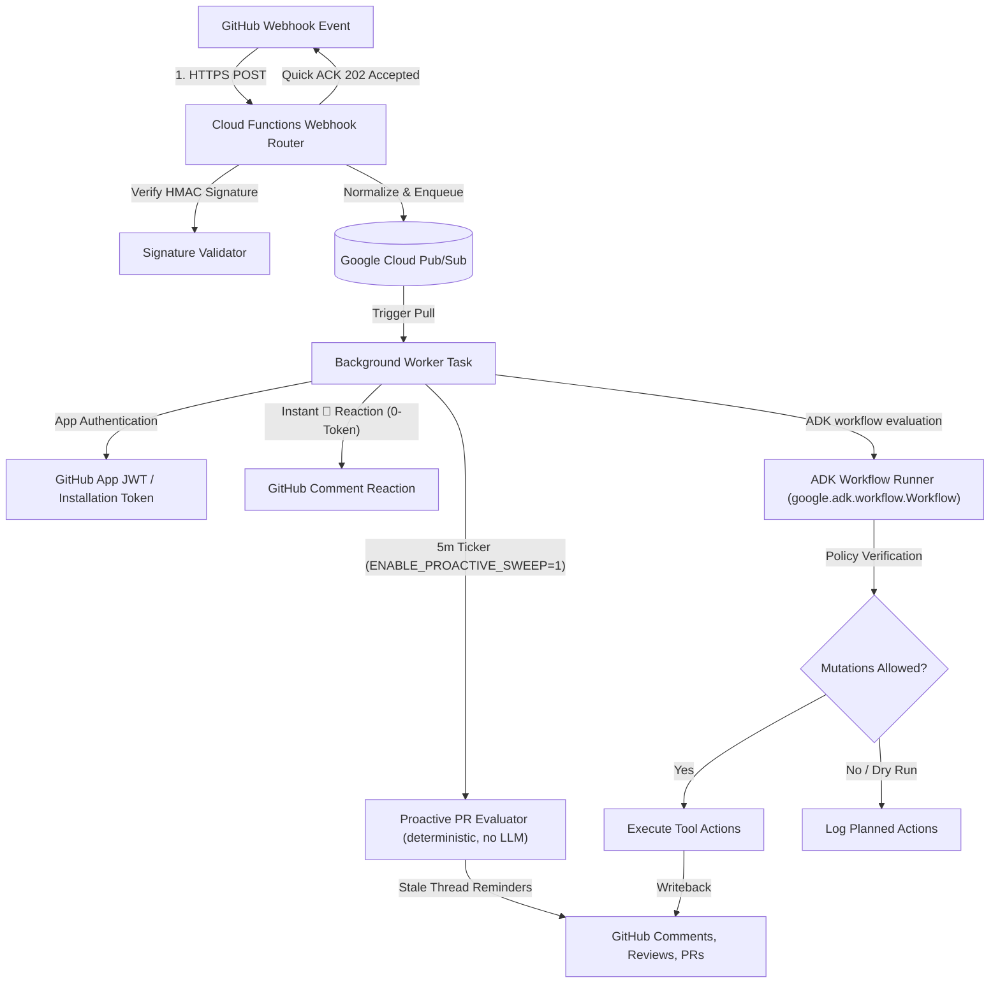

# 🤖 Hannibal Hub Agents: Distributed GitHub App Webhook Orchestrator

A unified, event-driven service that handles GitHub webhooks via a serverless router, queues event processing asynchronously using **Google Cloud Pub/Sub**, and runs an agentic workflow powered by **Gemini 3.8 / 3.5 Flash**, **Google GenAI**, & **Google ADK** to safely orchestrate GitHub repository reviews, review-thread collaboration, and proactive PR hygiene sweeps.

---

## 🏗️ System Architecture

The orchestrator uses a decoupled, distributed architecture with a current ADK workflow runner and **Proactive PR Evaluator**:



---

## 📁 Repository Structure

```
├── .agents/skills/          # Localized agent operational skills
│   ├── gcloud-logging/      # GCP logging inspection protocol & project matrix
│   └── github-pr-manager/   # End-to-end GitHub PR lifecycle management
├── .github/workflows/       # GitHub Actions CI PR gate & VM deployment workflows
│   ├── ci.yml               # Automated lint, formatting, typecheck, and test gate
│   └── deploy.yml           # Automated CI/CD deployment to VM via IAP SSH
├── .githooks/pre-commit     # Tracked commit gate (lint, format, typecheck on staged Python)
├── assets/                  # Static assets and model registries
│   └── registries/          # Gemini model specs and capabilities
├── dev/                     # Developer tools (model sync, rate limits, fixture recording)
├── docs/                    # Architecture, model chain, plans, and technical documentation
├── scripts/
│   ├── load_secrets.sh      # Load environment variables dynamically from GCP Secret Manager
│   ├── migrate_pubsub_messages.py # Pub/Sub backlog migration helper
│   ├── setup_vm_user_service.sh   # VM user-space systemd service setup script
│   ├── hannibal-webhook-agent.service # User-space systemd unit file template
│   ├── publish_test_message.py    # Test webhook payload publisher
│   ├── ruff-all.sh                # Lint, format, and type-check runner shared with the hook
│   └── install-git-hooks.sh       # Pre-commit hook installer for lint & type validation
├── src/
│   ├── webhook_agent/       # Core Webhook Orchestrator Package
│       ├── analysis/        # Deterministic pre-audits (AST, symbol graph, test impact, diff filter, lockfile, security scan)
│       ├── core/            # ADK WebhookAgent, prompts, execution engine, event policy, callbacks, & plugins
│       ├── environment/     # Local & ephemeral PR workspace execution contexts
│       ├── github/          # GitHub App auth, bot identity, PR context, thread resolver, & Jules API/proxy
│       ├── models/          # Dynamic model chains, rate limiters, depleted-model registry, & factory
│       ├── review/          # Verdict parsing, grounding enforcement, AST/CI gates, duplicate detection, proactive sweeps, schemas & formatting
│       ├── state/           # Review checkpoints (14d sliding TTL), circuit breaker, & idempotency
│       ├── tools/           # Model-callable tools (GitHub API, AST analysis, diff, search)
│       ├── worker.py        # Pub/Sub subscriber entry point and sequential pull / sweep loop
│       ├── processor.py     # Event routing, deduplication, fast-paths, prefetch, & agent delegation
│       ├── constants.py     # Non-sensitive infra constants and static env-var defaults
│       └── webhook_types.py # Common dataclasses and ActionResult definitions
├── router/                  # Serverless webhook ingress (Cloud Functions entry point)
│   ├── main.py              # HMAC verify, event classify, normalize, Pub/Sub publish
│   └── requirements.txt     # Router-only deploy dependencies
├── tests/
│   ├── eval/                # Continuous quality evaluation datasets & configs
│   ├── fixtures/            # Sample webhook payloads & review event fixtures
│   └── unit/                # Domain-mirrored unit test suite (analysis, core, environment, github, models, review, router, state, tools)
├── main.py                  # Distributed process manager entry point
├── pyproject.toml           # Dependency & pytest specification (uv-compatible)
└── README.md                # Repository documentation
```

> **Note:** `router/` is deployed independently of this repository's workflows — `.github/workflows/deploy.yml` only updates the VM worker, so changes under `router/` require a manual function redeploy.

---

## ⚡ High-Efficiency Token Optimization & Advanced Features

The project includes built-in strategies to maximize context efficiency, eliminate unnecessary LLM calls, and execute 1-turn webhook responses:

1. **ADK workflow evaluation**:
   - Event scope is classified deterministically by `resolve_event_policy()` (`core/policy.py`), which assigns one of `FORMAL_AUDIT`, `THREAD_COLLAB`, `ISSUE_TRIAGE`, or `IGNORE` before any model call.
   - Pull-request context and diffs are hydrated before model evaluation.
   - Structured review output is normalized before writeback.
2. **Proactive PR Evaluator (`ProactiveEvaluator`)**: currently **dormant** — read this before wiring it up.
   - Runs a 5-minute background ticker in the worker process. The ticker requires `ENABLE_PROACTIVE_SWEEP=1`, which nothing in this repo or its deploy path currently sets.
   - Pure deterministic PR hygiene: it never invokes an LLM. It has one signal — **Stale Review Threads**: *inline* review comments idle >24h ➔ posts a `Proactive Reminder: Unresolved Feedback` issue comment. Formal review bodies are deliberately excluded, so a PR with no inline review comments never triggers it.
   - Its comment write is not routed through `evaluate_writeback_policy()`, so `ALLOW_AUTOMATED_MUTATIONS=0` would **not** suppress it if the sweep were enabled.
   - CI status is handled separately by the pre-review gate in `review/ci_gate.py`, not by this sweep.
3. **Universal String Normalizer (`clean_field_string`), applied via Pydantic `field_validator`s**:
   - Strips leading Markdown bullets, emoji badges, or key label prefixes (`Update Summary:**`, `**Executive Summary:**`) across all Pydantic schemas (`CodeReviewResponse`, `SyncReviewResponse`, `IssueItem`, `RiskItem`, `SyncResolutionItem`) to eliminate redundant label echo in generated markdown.
4. **Tier-Aware Model Chains & 503 Failover**:
   - Dynamically routes requests based on active environment tier (`WEBHOOK_TIER`).
   - Cascades from cost-optimized primary model (`gemini-3.5-flash-lite` across tiers, with `gemini-3.8-flash` escalation for deep audits) through the Flash-Lite and Flash tiers. Gemma models are appended **only on the free tier**, and only when the payload is within their 14k-token ceiling.
   - Features instant `0.5s` failover on `503 UNAVAILABLE` high-demand server spikes while preserving 429 rate limit backoff.
5. **Resolution Tracking & Re-Review Templates**:
   - Tracks each prior finding's `status` field (`RESOLVED` vs `UNRESOLVED`, rendered ✅ / 🔴) across commits using structured schema validation.
6. **Guarded Programmatic 👀 Reaction**:
   - Adds an `eyes` reaction to user comments and valid PR events once closed/merged PR checks and deduplication locks pass.
7. **Dual-Engine Architecture (Automated Reviews + Conversational Pair Programming)**:
   - Eliminates rigid slash command requirements: automatically conducts formal clinical reviews on PR lifecycle events (`pull_request.opened`, `pull_request.synchronize`, `pull_request.ready_for_review`).
   - Supports natural-language pair programming, architecture Q&A, and discussion on PR threads, while seamlessly routing to full re-audits whenever review intent is detected (`please review`, `audit this`, `/review`).

---

## ⚙️ Configuration

Key environment variables configuring orchestrator operation:

| Variable | Default | Description |
| :--- | :--- | :--- |
| `TRIGGER_ALLOWED_ASSOCIATIONS` | `OWNER,MEMBER,COLLABORATOR,CONTRIBUTOR` | Comma-separated list of permitted author associations for triggering actions. |
| `TRIGGER_EXEMPT_LOGINS` | `cgj8702,cgj8702-agents,dependabot[bot],google-labs-jules[bot]` | Comma-separated list of user or bot logins exempt from author association checks. |
| `ENABLE_PR_WORKSPACE` | `1` | Clone PR head into an ephemeral sandbox workspace for accurate AST, symbol, and diff analysis (`1` = enabled, `0` = disabled). |
| `LOG_LEVEL` | `INFO` | Application logging verbosity (`DEBUG`, `INFO`, `WARNING`, `ERROR`). |
| `ALLOW_AUTOMATED_MUTATIONS` | `1` | Master policy gate for automated writeback actions (comments, formal reviews). |
| `REVIEW_WAIT_FOR_CI` | `1` | Hold automatic reviews until every check on the PR head commit is green. CI still running ➔ defer silently; CI failed ➔ skip silently. Set `0` to review immediately. See `review/ci_gate.py`. |
| `ENABLE_AUTOMATIC_PR_REVIEWS` | `1` | Review opened/synchronized PRs automatically once CI is green. Set `0` to require manual `/review` triggers. |
| `ENABLE_REVIEW_RESUME` | `0` | Enable the periodic sweep that resumes paused review checkpoints (see `docs/CHECKPOINT_RESUME.md`). |
| `REVIEW_RESUME_INTERVAL_SECONDS` | `60` | Seconds between checkpoint resume sweeps, when `ENABLE_REVIEW_RESUME=1`. |
| `DRY_RUN` | `0` | Log every planned mutation without writing anything back to GitHub. |
| `ENABLE_JULES_PR_PROXY` | `0` | Re-open Jules-authored PRs as `cgj8702-agents` so third-party review tools accept them (see `github/jules_proxy.py`). |
| `WEBHOOK_TIER` | `free` | Active model tier (`free` or `paid`), determining Gemini model cascade and API keys. |
| `STRICT_REVIEW_GROUNDING` | `1` | When `1` (default), reject or downgrade review submissions whose citations cannot be verified against the diff. Set `0` to log only. |
| `NATIVE_STALE_REVIEW_DISMISSAL_REPOS` | `cgj8702-org/hannibal-hub-agents` | Comma-separated repositories where GitHub native branch protection auto-dismisses stale reviews on push, causing the bot to skip manual review dismissal. |

---

## 🚀 Getting Started

### 1. Installation
This project uses `uv` for lightning-fast dependency management:

```bash
# Sync dependencies and set up the virtual environment
uv sync

# Install the tracked pre-commit hook for this clone
./scripts/install-git-hooks.sh
```

The installer configures `core.hooksPath=.githooks` locally. The official hook then runs
pre-commit linting and type checks for every commit and re-stages only Python files that were already
staged. It never adds an unstaged Python file to the commit.

### 2. Running Tests
Run the suite exactly as CI does (`--strict-markers -m 'not regression'`, so `regression`-marked tests are excluded):

```bash
uv run pytest
```

---

## 🛠️ Operations & Deployment

### Running the Background Worker
Start the worker process locally:

```bash
uv run python main.py
```

### VM Deployment & User-Space Systemd Service
On the target VM (`hannibal-hub-free`), the agent runs as a user-space systemd service (`hannibal-webhook-agent.service`):

```bash
# Initialize and start the user-space systemd service
bash scripts/setup_vm_user_service.sh

# Monitor service status on VM
systemctl --user status hannibal-webhook-agent.service

# Restart service on VM
systemctl --user restart hannibal-webhook-agent.service

# Follow live service logs
journalctl --user -u hannibal-webhook-agent.service -f
```

Pushes to `main` touching `src/`, `scripts/`, `main.py`, `pyproject.toml`, `uv.lock`, or `deploy.yml` automatically trigger [`.github/workflows/deploy.yml`](.github/workflows/deploy.yml) to deploy code updates and restart `hannibal-webhook-agent.service` via IAP SSH!
