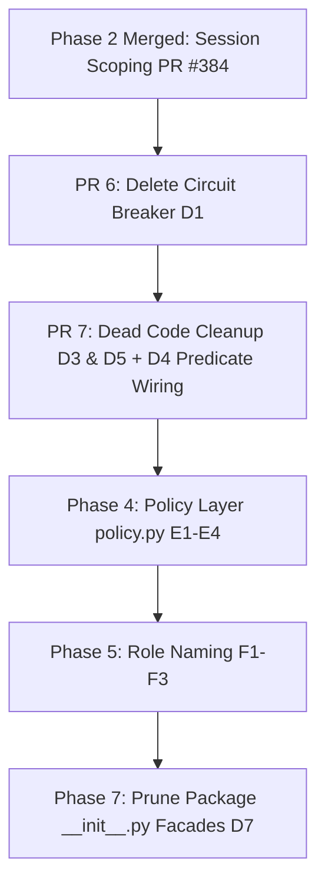

# Phase 3 Reclamation Investigations: D1, D3, D4, D5, D7

This directory contains the detailed forensic investigation reports for items **D1, D3, D4, D5, and D7** from [`docs/plans/repo_reclamation.md`](../plans/repo_reclamation.md).

---

## Executive Summary Matrix

| ID | Topic | Target File(s) | Original Intent | Real-World Status | Decided Fate | Resolution Order |
| :--- | :--- | :--- | :--- | :--- | :--- | :---: |
| [**D1**](d1_circuit_breaker.md) | Circuit Breaker | `src/webhook_agent/state/circuit_breaker.py` | Sliding window failure backoff for GitHub REST API calls | **0 callers in repo**; sync PyGithub mismatch; worker retry loop & Pub/Sub already handle backoff | **Delete** (Decision `P4`) | **#1** |
| [**D3**](d3_memory_remnants.md) | Dead Memory Parameters | `src/webhook_agent/core/prompts.py` | Feed cross-PR heuristics into Tier 2 repo prompt | **Unpopulated**; caller passes only repo name; memory service deleted in PR #382 | **Delete parameter** | **#2** |
| [**D4**](d4_scorecard_dimensions.md) | Unwired Scorecard Dimensions | `src/webhook_agent/review/review_enforcer.py` | Deterministic floor enforcement for Contract, Security, and Test Coverage | **Fully wired & enforced end-to-end**; standalone predicates were redundant with inline `matches_dimension` | **Resolve P6 as Not a Bug**; wire helpers into `matches_dimension` | **#3** |
| [**D5**](d5_test_only_functions.md) | Test-Only Functions | `models/model_chain.py`, `models/review_budget.py`, `review/schemas.py` | Token limit calculation, token counting, round suppression, summary risk scraping | **4 functions are dead stubs** with 0 callers; 2 dimension helpers belong to D4 | **Delete 4 dead functions**; wire 2 helpers | **#2** (with D3) |
| [**D7**](d7_dead_reexports.md) | Dead Re-exports in Facades | `__init__.py` across 7 subpackages | Shims from flat `logic/` migration in PR #227 | **32+ unused re-exports**; internal service has no public API consumers | **Prune facades** (Phase 7 `H3`) | **#5** (Final pass) |

---

## Unified Resolution Roadmap & Sequencing Order

### Sequencing Rationale:
1. **PR 6 (D1 — Circuit Breaker):** Immediate behavior-neutral deletion of 285 lines (`circuit_breaker.py` + tests). Resolves Decision **P4**.
2. **PR 7 (D3, D5, D4 — Parameter & Dead Helper Pruning):**
   - Delete `memory_bank_heuristics` from `build_repo_profile_context()` (D3).
   - Delete `_get_model_tpm_limit()`, `_count_tokens_exact()`, `should_suppress_round()`, and `has_genuine_summary_risk()` (D5).
   - Refactor `matches_dimension()` to cleanly invoke `is_contract_dimension()`, `is_security_dimension()`, and `is_test_coverage_dimension()` (D4 / Decision **P6**).
3. **Phase 4 (`policy.py`):** Unify writeback policy and tool gating into a single pure resolution function.
4. **Phase 5 (`F1`–`F3`):** Rename `_code_auditor` → `reviewer` and `_conversational_agent` → `collaborator`.
5. **Phase 7 (`H3` / D7):** Prune all dead re-exports from package `__init__.py` files once all module interfaces are finalized.

---

## Reports Index
- [`d1_circuit_breaker.md`](d1_circuit_breaker.md)
- [`d3_memory_remnants.md`](d3_memory_remnants.md)
- [`d4_scorecard_dimensions.md`](d4_scorecard_dimensions.md)
- [`d5_test_only_functions.md`](d5_test_only_functions.md)
- [`d7_dead_reexports.md`](d7_dead_reexports.md)
