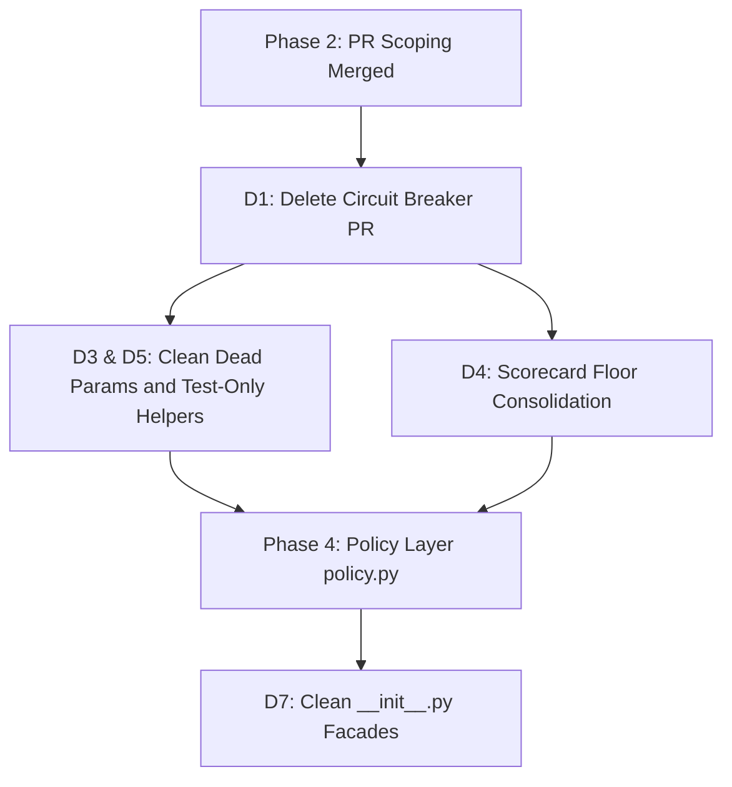

# Investigation Report: D1 — Circuit Breaker Subsystem

- **Item:** `D1` / Decision `P4`
- **Component:** `src/webhook_agent/state/circuit_breaker.py` (148 source lines)
- **Associated Tests:** `tests/unit/state/test_circuit_breaker.py` (135 test lines)
- **Status:** Complete Investigation & Recommendation

---

## 1. WHY It Exists in the First Place

### 1.1 Commit Origin and Historical Intent
The circuit breaker subsystem was introduced on **Sun Sep 27 2026** in commit [`bad23084686d9ac501f99b0a98103b1e7f1a0637`](file:///home/carly/coding/synced-repos-cgj8702/hannibal/hannibal-hub-agents/docs/plans/repo_reclamation.md) (PR #183):
```
feat(webhook_agent): implement PR template schema enforcer, AST diff chunk analyzer, and thread-safe circuit breaker (#183)
```
The original architectural goal was to protect the webhook processing pipeline from cascading failures when interacting with external services (specifically the GitHub REST API and Google GenAI APIs). When upstream rate limits (`429`), server errors (`503`), or network connection drops occurred repeatedly, a classic Martin Fowler-style circuit breaker was intended to:
1. Track consecutive failures and failure timestamps within a 60-second sliding window (`failure_threshold = 5`).
2. Trip from `CLOSED` to `OPEN` for a 30-second cooldown period (`recovery_timeout = 30.0`), failing fast via `CircuitOpenError` rather than hammering a degraded external API.
3. Transition to `HALF_OPEN` to permit a single probe request to confirm service recovery before closing the circuit.
4. Execute exponential backoff with randomized multiplicative jitter (`base_delay * 2^attempt * uniform(0.8, 1.2)`).

### 1.2 Why It Became Dead Code
Although PR #183 authored the complete implementation of `CircuitBreaker` along with unit tests, **it was never integrated into any call site**:
1. **Synchronous vs. Asynchronous Impedance Mismatch:**
   `CircuitBreaker.call_async()` is an asynchronous coroutine guarded by an `asyncio.Lock()`. However, the repository's GitHub integration (`PyGithub` / `github.Github`) is strictly synchronous and blocking. None of the GitHub writeback or read operations in `processor.py`, `execution.py`, or `tools/github_tools.py` run in an async event loop that could naturally await `CircuitBreaker.call_async()`.
2. **Duplication of Resilience Layers:**
   Between September and October 2026, other targeted resilience mechanisms were implemented directly at the worker and execution boundaries:
   - **Worker Polling & Retry Loop (`src/webhook_agent/worker.py:81-109, 350-374`):** The worker implements `_is_transient(exc)` with `_RETRY_DELAYS = [2.0, 5.0, 10.0]` and pseudo-random jitter. It handles `GithubException` (429, 500-504, 403 rate limits), `gcp_exceptions`, `httpx.TransportError`, and `ServerError`.
   - **Pub/Sub Lease Heartbeat Extender (`worker.py:115-125`):** While processing long-running reviews, `_lease_extender` periodically renews message deadlines, preventing redelivery storms without needing circuit breakers.
   - **Firestore/Local Review Checkpoint Backoff (`src/webhook_agent/state/review_checkpoint.py`):** When rate limited by Gemini, `review_checkpoint_manager.mark_rate_limited()` records `resume_after_ts` with sliding exponential backoff, cleanly pausing reviews per PR without dropping state.
   - **Dynamic Model Chain Failover (`src/webhook_agent/models/model_chain.py`):** Model exhaustion or 429s automatically cascade across model tiers via `_advance_model_chain()`.
3. **Isolation in `state/__init__.py`:**
   During the subpackage decomposition in PR #227 (commit `a82be6340a9`), `circuit_breaker.py` was placed into `webhook_agent.state` and exported in `__init__.py`. However, no production code imports `webhook_agent.state` as a package. Live consumers (`processor.py`, `execution.py`, `review_enforcer.py`) import `review_checkpoint` and `review_idempotency` directly.

The result is a docstring and module claiming to provide external API circuit breaking when, in reality, zero requests flow through it.

---

## 2. WHAT Our CURRENT Options Are

| Option | Implementation Scope | Lines Changed | Pros | Cons / Risks |
| :--- | :--- | :---: | :--- | :--- |
| **Option 1: Complete Deletion (Recommended)** | Delete `src/webhook_agent/state/circuit_breaker.py`, `tests/unit/state/test_circuit_breaker.py`, and remove exports from `src/webhook_agent/state/__init__.py`. | **-285 lines** (~148 source, ~135 test, ~2 export) | • Removes 285 lines of unmaintained dead code.<br>• Restores truth to the codebase: no false claims of circuit breaking in docs.<br>• Zero behavioral change; zero risk to production. | • If a global circuit breaker is ever required in the future, it must be rewritten (or retrieved from git history). |
| **Option 2: Wire Up to PyGithub Calls** | Create a synchronous wrapper or decorator, instantiate a singleton `github_circuit_breaker`, and route all `gh.get_repo()`, `pr.create_review()`, and `issue.create_comment()` calls through it. | **+80 to +120 lines** | • Provides explicit circuit tripping if GitHub API suffers widespread outage. | • Heavy refactor across `github/`, `review/`, and `tools/`.<br>• High risk of blocking valid webhooks during single-call transient errors.<br>• Redundant with existing Pub/Sub ack/nack retry architecture. |
| **Option 3: Wire Up to Model Execution** | Route `_execute_adk_runner` or `genai.Client` calls through an async circuit breaker. | **+40 to +60 lines** | • Fails fast if the Gemini API has a prolonged regional outage. | • Conflicts directly with `_advance_model_chain()` which already rotates models on 429/503.<br>• Model rotation is granular per model; a global circuit breaker would trip even when backup models are healthy. |

### Architectural Evaluation
In a distributed queue architecture (Google Cloud Run Router → GCP Pub/Sub → GCE VM Worker), **Pub/Sub itself is the circuit coordinator**. When an external API fails, the worker raises an exception or leaves the message unacknowledged. Pub/Sub applies dead-lettering, exponential redelivery backoff, and message leases. Adding an in-memory process-local circuit breaker adds unnecessary statefulness to a worker that pulls single messages (`max_messages: 1`).

---

## 3. HOW We Will Decide Its Fate (Decision P4)

Decision **P4** in `docs/plans/repo_reclamation.md` Part 5 asks:
> *Circuit breaker: delete or wire up?*

### Decision Criteria:
1. **Reachable Caller Invariant:** Does any live code path in `src/` call `CircuitBreaker` or `call_async`?
   - **Verification:** `git grep "CircuitBreaker"` returns only its own definition, `state/__init__.py`, and `test_circuit_breaker.py`. Caller count is strictly **0**.
2. **Resilience Redundancy:** Are transient failures already caught and retried?
   - **Verification:** `worker.py` contains verified retry loops with jitter (`_is_transient`), Pub/Sub ack deadline extension (`_lease_extender`), and checkpointed state resumption.
3. **Maintainability Cost:** Keeping an unwired 148-line module requires ongoing maintenance (type checking, linter updates, Python version compatibility) for zero runtime benefit.

### Verdict on P4:
**Adopt Option 1: Delete `circuit_breaker.py` and its test.** Record decision **P4 = Delete** in `docs/plans/repo_reclamation.md`.

---

## 4. In WHAT Order It Should Be Resolved

Resolving D1 has **zero inbound dependencies** and **blocks no other features**. However, it should be sequenced logically within the broader reclamation roadmap:



### Sequencing Order:
1. **Step 1 (Immediate Next PR):** Delete `circuit_breaker.py` (D1). This is a purely behavior-neutral deletion that shrinks the codebase by ~285 lines and cleanly closes Decision **P4**.
2. **Step 2:** Prune dead memory parameters (D3) and dead test-only functions (D5).
3. **Step 3:** Clarify scorecard dimensions (D4).
4. **Step 4:** Implement `policy.py` (Phase 4).
5. **Step 5:** Retire package `__init__.py` dead re-exports (D7) once all module interfaces are finalized.
