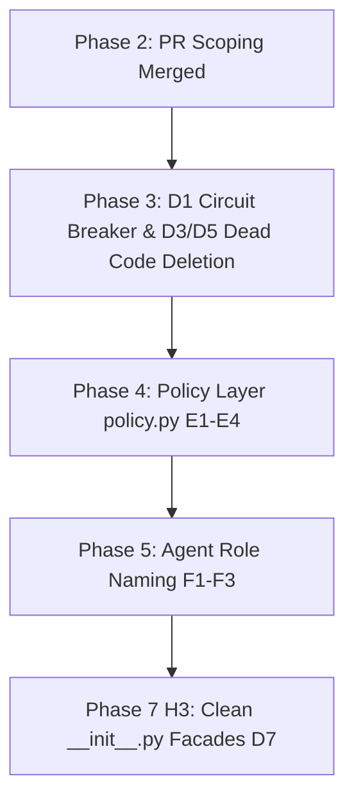

# Investigation Report: D7 — Package `__init__.py` Facade Re-exports

- **Item:** `D7` / Phase 7 (`H3`)
- **Scope:** 7 subpackage `__init__.py` files across `src/webhook_agent/` (~32+ dead re-exports)
- **Status:** Complete Investigation & Strategy

---

## 1. WHY Those Facades Exist in the First Place

### 1.1 The Shim Era Architecture
In early September 2026, the Hannibal Hub repository housed almost all agent logic in a single flat directory (`src/webhook_agent/logic/`) and a monolithic orchestrator (`webhook_agent.py`).

In PR #227 (commit `a82be6340a9`, Mon Oct 5 2026), the codebase underwent a major domain-driven decomposition into subpackages:
- `analysis/` (AST analyzer, dependency tree, symbol graph, test impact)
- `models/` (model chain, factory, rate limiter, depleted registry)
- `review/` (duplicate detector, enforcer, formatter, critic, hunter)
- `state/` (checkpoints, review claims, circuit breaker)
- `environment/` (sandboxed workspaces, local environments)
- `tools/` (ADK model-callable tools)
- `github/` (credentials, bot identity, PR context)

### 1.2 The Genesis of the `__init__.py` Facades
During this migration, hundreds of tests and internal call sites were importing from the old flat module paths. To prevent immediate breakage, the maintainers implemented:
1. `sys.modules` alias shims in `src/webhook_agent/logic/*`.
2. Comprehensive "facade" `__init__.py` files for each new subpackage, re-exporting every class, function, constant, and internal visitor in `__all__`.

In PR #249 and PR #314, the legacy `logic/` directory and shims were permanently deleted, and all active code and unit tests were updated to import directly from specific submodules (e.g. `from webhook_agent.review.review_enforcer import _enforce_verdict`).

However, **the `__init__.py` facades were never pruned**. They remained as vestigial artifacts, re-exporting dozens of symbols that no module in the entire repository ever imports.

---

## 2. Inventory of Dead Re-Exports

A repository-wide AST import audit revealed that **not a single production module in `src/` imports from `webhook_agent.state`, `webhook_agent.tools`, or `webhook_agent.environment`**. Every consumer imports leaf modules directly.

### 2.1 Most Glaring Facade Anomalies

| Package | Re-export | True Location | Why It Is Problematic |
| :--- | :--- | :--- | :--- |
| `analysis/` | `CallSiteVisitor` | `analysis/symbol_graph.py` | Internal AST visitor helper class. Re-exporting it suggests it is a public API. |
| `analysis/` | `SymbolDefinitionVisitor` | `analysis/symbol_graph.py` | Internal AST visitor helper class. |
| `analysis/` | `ASTAnalysisResult` | `analysis/ast_analyzer.py` | Zero consumers import it from `analysis`. |
| `state/` | `CircuitBreaker` | `state/circuit_breaker.py` | Dead module with 0 callers (see D1). |
| `github/` | `_is_bot_event`, `_should_prefetch_diff` | `github/bot_identity.py` | Private functions (`_`) exported in `__all__` of a package facade. |
| `review/` | `_enforce_verdict`, `_add_eyes_reaction` | `review/review_enforcer.py` | Private implementation details exported in `__all__`. |
| `tools/` | Lazy `__getattr__` mapping | `tools/__init__.py` | 63 lines of dynamic `importlib` machinery with zero callers in `src/` or `tests/`. |

---

## 3. WHAT Our CURRENT Options Are

| Option | Implementation Scope | Pros | Cons / Tradeoffs |
| :--- | :--- | :--- | :--- |
| **Option 1: Surgical Pruning to True Package Entry Points (Recommended)** | Keep `__init__.py` files, but strip all internal helpers, visitor classes, and private functions. Export only primary domain abstractions (e.g. `WebhookAgent`, `WebhookProcessor`, `ReviewCheckpointManager`). | • Clean public contracts. • Prevents accidental cyclic import loops. • Removes ~180 lines of boilerplate re-exports. | • Requires updating any legacy test that relied on package-level imports. |
| **Option 2: Empty `__init__.py` Files** | Remove all imports and `__all__` definitions from subpackage `__init__.py` files, leaving only package docstrings (standard Python namespace style). All callers must import explicitly from leaf modules. | • Maximum transparency: no magic facade imports. • Zero risk of circular dependencies. • Fastest import startup time. | • Callers cannot do `from webhook_agent.review import CodeReviewResponse`. |
| **Option 3: Status Quo** | Leave all `__init__.py` facades intact. | • Zero code changes. | • Code readers and AI agents assume these symbols are public APIs. • Masks dead code during static audits. |

---

## 4. HOW We Will Decide Their Fate

### Crucial Architectural Fact:
> **Hannibal Hub is an internal webhook orchestrator service, NOT a public library published to PyPI.**

Because this codebase is not a public library:
1. There are **zero external downstream consumers** relying on stable `from webhook_agent.<package> import ...` imports.
2. The sole consumers of this code are `worker.py`, `processor.py`, and the test suite.
3. Every production file already imports from specific leaf modules (e.g. `from webhook_agent.review.review_enforcer import ...`).
4. Maintaining bloated `__init__.py` files that re-export private functions (`_enforce_verdict`) and internal AST visitors (`CallSiteVisitor`) provides **negative value**.

### Decision:
**Adopt Option 1 (with progression toward Option 2):**
1. Remove all private (`_`) functions from `__all__` and `__init__.py`.
2. Remove all internal visitors and single-module data transfer objects.
3. Replace the dynamic lazy-loader in `tools/__init__.py` with standard leaf module imports.

---

## 5. In WHAT Order It Should Be Resolved

Resolving D7 should be sequenced **at the end of the reclamation roadmap (Phase 7, `H3`)**:

### Sequencing Rationale:
1. **Avoid Merge Conflicts with Feature Work:**
   Phase 3 (`D1`, `D3`, `D5`) and Phase 4 (`policy.py`) will modify imports in `core/`, `review/`, and `tools/`. Pruning `__init__.py` facades *after* `policy.py` lands ensures that the final facade cleanup touches stable, finalized module boundaries.
2. **Dedicated PR:**
   Per `repo_reclamation.md` §463, `H3` should be handled as its own dedicated PR with clean diffs.
