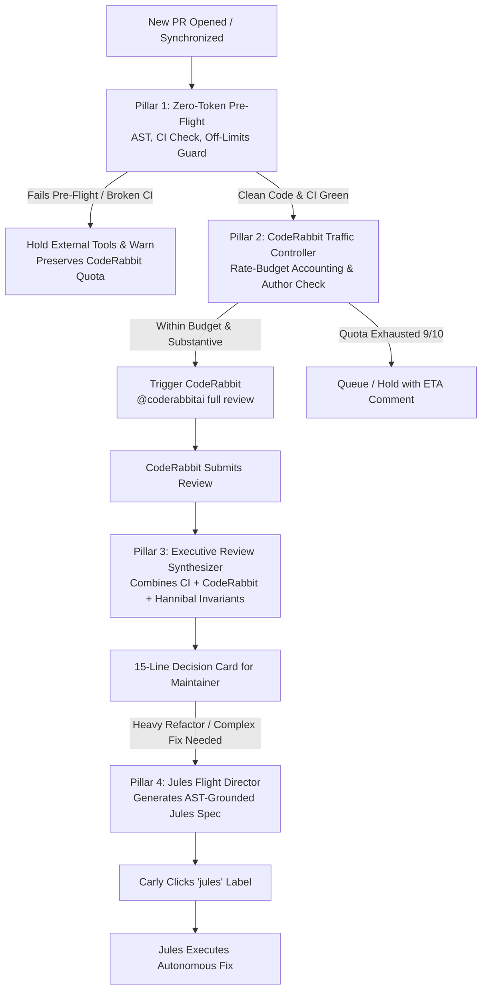

# Orchestrator Evolution Plan: Multi-Agent Triage & Flight Director

**Status:** Draft for Implementation  
**Origin:** Synthesis of real-world operational constraints (CodeRabbit 10 PRs/hr limit, Jules owner-only label summoning, CodeRabbit bot-author refusal, and Hannibal free-tier LLM limits).  
**Goal:** Transform Hannibal from a defensive, free-tier-constrained code reviewer into a high-leverage **Multi-Agent Orchestrator and Triage Flight Director**.  

**Companion file:** `orchestrator_evolution_tasks.md` (same directory) breaks down every phase into checkable, single-PR tasks with verifiable acceptance criteria.

---

## 1. Executive Summary & Strategic Rationale

Hannibal Hub Agents operates within a complex web of external services and hard constraints:

| Entity | Real-World Constraint / Friction | Superpower to Exploit |
| :--- | :--- | :--- |
| **CodeRabbit** | Hard cap of 10 PRs/hour; refuses to review bot-authored PRs (`*[bot]`); quota burned on failing CI or docs. | Best-in-class static analysis, AST security scanning, and deep multi-file code review. |
| **Jules** | Google backend **only** triggers when personal account `cgj8702` attaches the `jules` label; requires pristine structured markdown specs. | Autonomous coding agent capable of implementing complex multi-file features and bug fixes. |
| **Hannibal** | Free-tier LLM API quota (6 calls/audit, 3 comments/min rate limiter); zero-mutation policy for autonomous bots. | Webhook-native, continuous VM presence, persistent memory/state, zero-token deterministic AST analysis (`src/webhook_agent/analysis/`). |
| **Human Maintainer (`cgj8702`)** | Finite cognitive bandwidth; bottlenecked by clicking labels, reading comment walls, and writing specs. | Sovereign project owner with authority to approve, merge, and launch autonomous runs. |

### The Core Architectural Pivot

Rather than burning Hannibal's 6 free-tier LLM calls trying to mimic CodeRabbit's line-by-line static analysis, Hannibal evolves to become the **Orchestration Hub**:
1. **The Gatekeeper & Quota Bouncer:** Enforce zero-token deterministic pre-flight checks (`analysis/`). Suppress or hold CodeRabbit calls on trivial diffs or failing CI to protect the 10 PRs/hour budget.
2. **The Executive Review Synthesizer:** Ingest CodeRabbit’s review submission webhook, filter out cosmetic noise, cross-reference with CI and repo invariants, and post a single 15-line **Executive PR Decision Card** for the maintainer.
3. **The Jules Flight Director:** Transform the "only Carly can label" constraint into an intentional 1-click **Human Authorization Gate**. Hannibal drafts battle-ready Jules Task Specifications, allowing the maintainer to launch Jules with a single click.
4. **Lightweight Server-Side RBAC:** Enable safe, authenticated maintainer commands without exposing unauthenticated mutation tools.

---

## 2. Architectural Pillars

### Pillar 1: Zero-Token Deterministic Pre-Flight Gate (The Bouncer)

**Why:** Reviewing broken code or non-code diffs with LLMs or third-party tools is pure waste. Hannibal already has a deterministic analysis engine in `src/webhook_agent/analysis/` that runs in under 150ms on the VM and costs **0 tokens**.

**Capabilities:**
- **Off-Limits Shield:** Automatically checks if a PR touches protected paths (`.githooks/*`, `.github/workflows/*`, credentials, model configs, `MODEL_CHAIN.md`).
- **CI Gate Synchronization:** Asserts check runs are green before invoking external review tools.
- **Substantive Code Filter:** Distinguishes documentation-only updates from structural logic changes.
- **Test Impact Verification:** Flags when code symbols are modified without corresponding test file modifications.

---

### Pillar 2: CodeRabbit Traffic Controller & Quota Guardian

**Why:** CodeRabbit enforces a hard limit of 10 PRs/hour. In rapid pair-programming sprints, this quota is easily exhausted. Furthermore, CodeRabbit ignores bot-authored PRs.

**Capabilities:**
- **Rolling Quota Accountant:** Tracks CodeRabbit invocations within a rolling 60-minute window in worker memory (backed by Firestore persistence).
- **Proactive Throttle Shield:** When the quota reaches 8/10 or 9/10, Hannibal defers invocation and posts an advisory comment: *"⚠️ CodeRabbit quota at 9/10 this hour. Holding review request for 12m to prevent rate exhaustion."*
- **Trivial Diff Bypass:** Docs-only changes (`*.md`, `*.txt`) bypass CodeRabbit review entirely.
- **Bot Persona Verification:** Ensures automated branches target proper machine-user commit authorship (`cgj8702-agents`) rather than `*[bot]`, allowing CodeRabbit to process legitimate team PRs.

---

### Pillar 3: Executive Review Synthesizer

**Why:** Maintainers suffer from comment-wall fatigue. CodeRabbit leaves 5–15 inline comments containing a mix of critical bugs, cosmetic style points, and false positives. Hannibal should not compete with CodeRabbit's inline findings; Hannibal should synthesize them.

**Capabilities:**
- **Review Webhook Ingestion:** Ingests `pull_request_review.submitted` events where `sender.login == "coderabbitai[bot]"`.
- **Triage Classification:** Classifies CodeRabbit comments into *Actionable Defect* (security, logic, schema mismatch) vs *Cosmetic / Style* (docstring formatting, variable renaming).
- **The Executive Decision Card:** Posts a concise markdown summary (maximum 15 lines):
  - **CI & Test Impact:** Green status across affected modules.
  - **Repo Invariants:** Conventional commits, machine author, zero-bypass verified.
  - **CodeRabbit Triage:** Highlight of actionable findings vs cosmetic suggestions.
  - **Clear Verdict:** Explicit recommendation for Carly ("Safe to merge" vs "Action required on file X").

---

### Pillar 4: Jules Flight Director (Human-in-the-Loop Spec Launchpad)

**Why:** Jules requires two things: (1) an owner-applied `jules` label (`cgj8702`), and (2) a structured markdown task specification. When a human has to inspect the repo and manually draft the spec, velocity stalls.

**Capabilities:**
- **Trigger Detection:** Triggered by `/jules-prep` comment or when an issue/review explicitly requests autonomous implementation.
- **AST-Grounded Spec Generation:** Inspects repository AST and symbol graphs to generate:
  - Exact target file paths.
  - Architecture and invariant constraints.
  - Strict acceptance criteria and verification commands (`./scripts/ruff-all.sh`, targeted pytest).
- **1-Click Launchpad CTA:** Formats the output with a prominent call-to-action:
  > 🚀 **Jules Mission Ready:** To launch autonomous execution with this spec, apply the `jules` label to this issue/PR.

---

### Pillar 5: Lightweight Maintainer RBAC & Command Engine

**Why:** The Zero-Mutation policy was an over-correction that deleted tools to avoid unauthenticated caller attacks. We restore maintainer control safely by enforcing server-side role-based access control.

**Capabilities:**
- **Server-Side Sender Verification:** Validates `author_association in ('OWNER', 'MEMBER', 'COLLABORATOR')` directly on webhook payloads before executing any maintainer command.
- **Slash Commands Catalog:** Safe commands for maintainers:
  - `/triage` — Run zero-token AST audit and report impact.
  - `/jules-prep` — Generate structured Jules mission specification.
  - `/quota` — Report current CodeRabbit and Gemini rate-limit utilization.
  - `/review` — Force CodeRabbit review dispatch.
- **Audit Logging:** Every command execution logs actor, command, target PR, and outcome.

---

## 3. Implementation Phases

### Phase 1: Zero-Token Pre-Flight Gatekeeper
- **Seams:** `src/webhook_agent/analysis/diff_filter.py`, `src/webhook_agent/processor.py`.
- **Logic:** Add `preflight_audit(ev)` executed immediately after event normalization. Intercept PRs touching off-limits paths or failing CI before invoking any agent or model turn.
- **Testing:** Unit tests verifying off-limits rejection, docs bypass, and CI check synchronization.

### Phase 2: CodeRabbit Quota Accountant & Traffic Controller
- **Seams:** `src/webhook_agent/state/quota_tracker.py`, `src/webhook_agent/github/jules_proxy.py`.
- **Logic:** Implement rolling 60-minute window tracker. Guard `request_coderabbit_review()` behind quota check and substantive code filter.
- **Testing:** Mocked time-series tests verifying 10-call cap, rolling expiration, and throttle comments.

### Phase 3: Review Event Ingestion & Executive Synthesizer
- **Seams:** `src/webhook_agent/processor.py`, `src/webhook_agent/review/executive_synthesizer.py`.
- **Logic:** Handle `pull_request_review.submitted` from `coderabbitai[bot]`. Parse review comments, categorize severity, and post the 15-line Executive Decision Card.
- **Testing:** Fixture-based tests parsing recorded CodeRabbit review payloads.

### Phase 4: Jules Flight Director & Spec Launchpad
- **Seams:** `src/webhook_agent/github/jules_spec_builder.py`, `src/webhook_agent/core/agent_definition.py`.
- **Logic:** Parse `/jules-prep`. Build AST-grounded specs with explicit verification criteria and 1-click CTA.
- **Testing:** Unit tests verifying spec output format, file extraction, and command inclusion.

### Phase 5: Maintainer RBAC & Command Engine
- **Seams:** `src/webhook_agent/github/rbac.py`, `src/webhook_agent/core/callbacks.py`.
- **Logic:** Server-side verification of maintainer identity before command routing. Generic refusal for unauthorized callers.
- **Testing:** Unit tests proving maintainer success and non-collaborator rejection.

---

## 4. Definition of Done

- [ ] Zero-token pre-flight intercepts off-limits and non-substantive diffs before agent execution.
- [ ] CodeRabbit quota accountant accurately enforces rolling 10 PRs/hour limit without quota exhaustion.
- [ ] CodeRabbit review webhooks trigger automated Executive PR Decision Cards.
- [ ] `/jules-prep` generates structured Markdown specs with 1-click CTA.
- [ ] Server-side RBAC validates maintainer permissions for all slash commands.
- [ ] All unit tests pass offline in CI (`uv run pytest tests/unit`).
- [ ] Zero lint or type errors via `./scripts/ruff-all.sh`.
